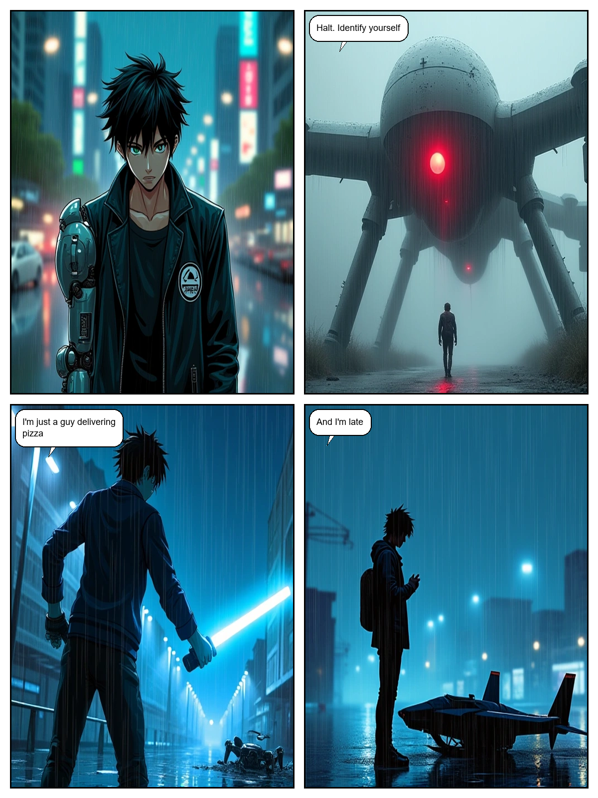
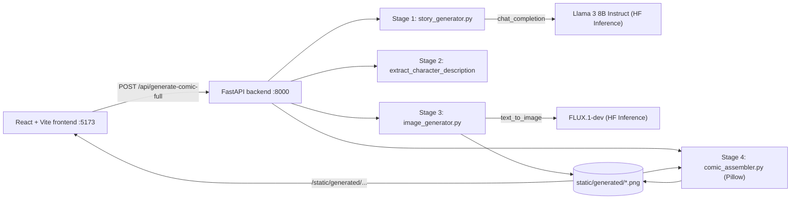
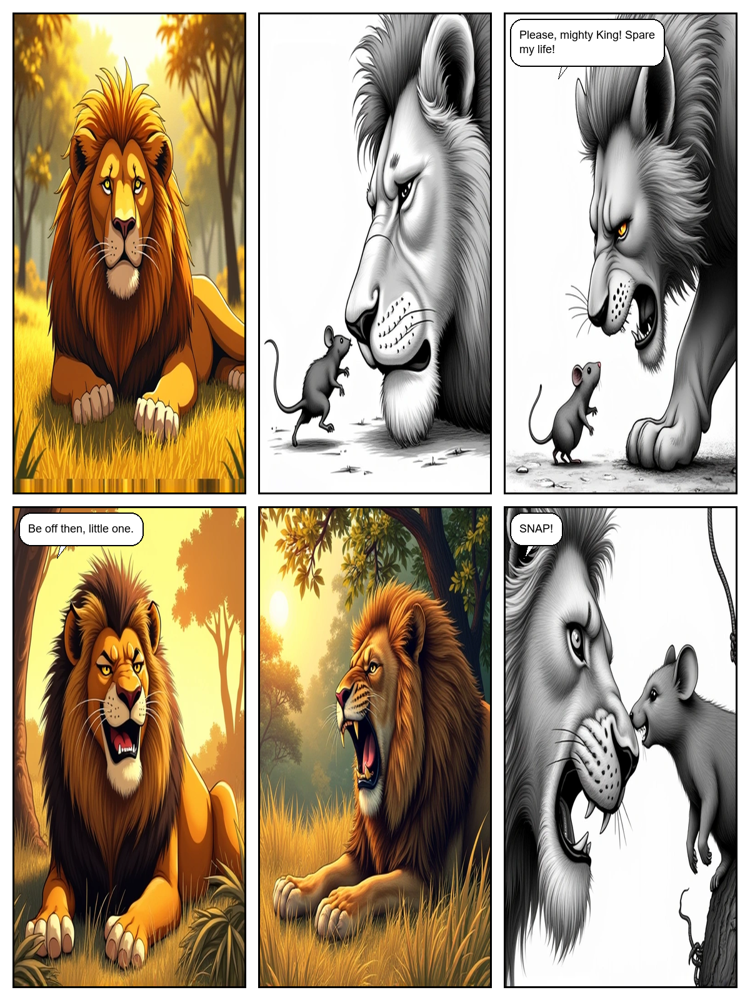

# AI Comic Book Generator

Type a short story, pick an art style, and get back a finished comic page: an LLM writes the panel script, a text-to-image model draws each panel, and the backend lays them out with speech bubbles.



## Overview

Turning a story idea into a comic normally needs a writer, an illustrator and a letterer. This project chains open models on the Hugging Face Inference API into a four-stage pipeline that plays those roles automatically:

1. **Director**: Meta Llama 3 8B Instruct converts the story into a structured JSON script (title, characters, and per-panel visual prompt and dialogue).
2. **Character Designer**: a short description of each character is taken from their first appearance so it can be reused in every panel.
3. **Cinematographer**: FLUX.1-dev generates one image per panel, with the character description prepended to the prompt ("prompt anchoring") to keep characters looking similar.
4. **Editor**: Pillow assembles the panels into a 1200 x 1600 page in a grid and draws speech bubbles with the dialogue.

A React web app drives the whole pipeline with one request and shows the panels, the assembled page and the raw script. It is a personal project and a working prototype.

## Key features

- Story to comic page in a single call (`POST /api/generate-comic-full`).
- Structured script generation with JSON extraction that tolerates Markdown fences and extra text around the LLM output.
- Four art style presets applied as prompt suffixes: American comic, Japanese manga, cinematic/realistic, and Pixar-like 3D.
- 1 to 8 panels per page (the web UI offers 2, 3, 4 or 6); the grid adapts (2 x 1, 2 x 2, 3 x 2, 3 x 3).
- Character consistency through prompt anchoring (no fine-tuning or image conditioning).
- Server-side page assembly with bordered panels, word-wrapped rounded speech bubbles and a grey placeholder for any panel that fails to load.
- Per-stage endpoints, so each stage can be called and tested on its own.
- Pipeline status reporting per stage (`completed`, `failed`, `pending`) and partial results when a later stage fails.
- Web UI with style and panel selectors, stage progress cards, a panel gallery with dialogue overlays, the final page, a PNG download button and a collapsible script view.

## Architecture



| Component | File | Responsibility |
|---|---|---|
| API server | [`backend/main.py`](backend/main.py) | Routes, CORS for the Vite dev server, orchestration of the four stages, static file serving. |
| Schemas | [`backend/schemas.py`](backend/schemas.py) | Pydantic models: `StoryInput`, `Panel`, `ComicScript`. |
| Director | [`backend/services/story_generator.py`](backend/services/story_generator.py) | Prompt design, LLM call, JSON extraction and validation, default filling. |
| Character Designer and Cinematographer | [`backend/services/image_generator.py`](backend/services/image_generator.py) | Style presets, character description extraction, reference sheet and panel image generation. |
| Editor | [`backend/services/comic_assembler.py`](backend/services/comic_assembler.py) | Grid layout, image resizing, borders, speech bubbles, PNG output. |
| Web app | [`frontend/src/App.jsx`](frontend/src/App.jsx) | Story form, pipeline status, results display and download. |

## How it works

1. The user enters a story, a panel count and a style in the web app, which sends `{story, num_panels, style_preset}` to `/api/generate-comic-full` (10-minute client timeout).
2. **Stage 1**: the backend builds a system prompt that asks for exactly *N* panels in a fixed JSON schema with detailed, consistent character appearance. Llama 3 is called with `max_tokens=2000` and `temperature=0.7`. The response is parsed directly, or extracted from a code block or the outermost `{...}`; missing `id`, `dialogue`, `character_name`, `title` or `characters` fields are filled in.
3. **Stage 2**: for each character, the first sentence of the visual prompt of their first panel becomes their anchor description.
4. **Stage 3**: for each panel the prompt is `"<character description>. <visual prompt><style suffix>, highly detailed"`. FLUX.1-dev returns an image that is saved as `static/generated/panel_<id>_<uuid>.png`. Failures are recorded per panel instead of aborting the run.
5. **Stage 4**: successful panels are resized into the grid on a white 1200 x 1600 canvas, each with a black border and, if the panel has dialogue, a speech bubble in the top-left corner. The page is saved as `comic_<title>_<uuid>.png`.
6. The response contains the script, character descriptions, per-panel results, the page URL and the stage statuses. The frontend loads images from `http://localhost:8000/static/...`.

## Tech stack

| Layer | Technologies |
|---|---|
| Frontend | React 19, Vite 7, Tailwind CSS 4, Axios, lucide-react |
| Backend | Python, FastAPI, Uvicorn, Pydantic 2 |
| AI models | `meta-llama/Meta-Llama-3-8B-Instruct` (script), `black-forest-labs/FLUX.1-dev` (images), SDXL and SDXL Turbo configured as alternatives in code |
| Model access | `huggingface_hub` `InferenceClient` |
| Image processing | Pillow |
| Config | python-dotenv |

## Project structure

```text
Comic-Book-Generator/
├── backend/
│   ├── main.py                    # FastAPI app and pipeline orchestration
│   ├── schemas.py                 # Pydantic request/response models
│   ├── services/
│   │   ├── story_generator.py     # Stage 1: LLM script writer
│   │   ├── image_generator.py     # Stages 2-3: character anchoring + panel images
│   │   └── comic_assembler.py     # Stage 4: page layout and speech bubbles
│   ├── static/generated/          # Generated panels and pages (sample outputs included)
│   ├── test_api.py                # Manual endpoint tests against a running server
│   ├── requirements.txt
│   └── .env.template              # Environment variable template
└── frontend/
    ├── src/App.jsx                # Single-page UI
    ├── src/main.jsx               # React entry point
    ├── index.html
    ├── package.json
    └── vite.config.js             # React + Tailwind plugins
```

## Getting started

### Prerequisites

- Python 3.11 or newer (Pillow 13 requires it)
- Node.js 20 or newer (required by Vite 7)
- A Hugging Face account and access token with permission to call Inference Providers. FLUX.1-dev is a gated model, so you may need to accept its terms on its Hugging Face page first.

### Backend

```bash
cd backend
python -m venv venv
source venv/bin/activate          # Windows: venv\Scripts\activate
pip install -r requirements.txt
cp .env.template .env             # then set HF_TOKEN
python main.py                    # serves on http://localhost:8000 with auto-reload
```

Interactive API docs: `http://localhost:8000/docs`.

### Frontend

```bash
cd frontend
npm install
npm run dev                       # http://localhost:5173
```

The backend only allows CORS from `localhost:5173` / `127.0.0.1:5173`, and the frontend calls `http://localhost:8000` (hard-coded in `App.jsx`).

### Environment variables

| Variable | Where | Purpose |
|---|---|---|
| `HF_TOKEN` | `backend/.env` | Hugging Face access token used for both the LLM and the image model. |

### Manual tests

[`backend/test_api.py`](backend/test_api.py) calls a running backend:

```bash
cd backend
python test_api.py script      # Stage 1 only (default)
python test_api.py character   # character reference sheet
python test_api.py panel       # single panel
python test_api.py assembly    # assemble existing panel_*.png files
python test_api.py full        # whole pipeline (several minutes)
```

These calls use real Hugging Face inference.

## API reference

| Method | Path | Body | Description |
|---|---|---|---|
| GET | `/`, `/health` | none | Status and whether `HF_TOKEN` is configured. |
| POST | `/api/generate-comic-full` | `{story, num_panels, style_preset}` | Full four-stage pipeline (used by the UI). |
| POST | `/api/generate-script` | `{story, num_panels}` | Stage 1 only; returns the script and raw LLM output. |
| POST | `/api/generate-comic` | `{story, num_panels}` | Earlier version that runs Stage 1 only and marks later stages `pending`. |
| POST | `/api/generate-character-ref` | `{character_name, character_description, style_preset}` | Generates a character reference sheet image. |
| POST | `/api/generate-panel` | `{panel_id, visual_prompt, character_desc, style_preset}` | Generates one panel. |
| POST | `/api/generate-all-panels` | list of panels | Generates every panel of a script. |
| POST | `/api/assemble-comic` | `{panel_images, dialogues, title}` | Assembles existing image files into a page. |
| POST | `/api/test-story` | `{story, num_panels}` | Echo endpoint for checking input. |

Example:

```bash
curl -X POST http://localhost:8000/api/generate-comic-full \
  -H "Content-Type: application/json" \
  -d '{"story": "A lion spares a tiny mouse, who later frees him from a hunter'\''s net.", "num_panels": 6, "style_preset": "comic"}'
```

Abridged response:

```json
{
  "status": "success",
  "message": "Comic generation completed!",
  "script": { "title": "...", "characters": ["..."], "panels": [{ "id": 1, "visual_prompt": "...", "dialogue": "...", "character_name": "..." }] },
  "character_descriptions": { "...": "..." },
  "panels": [{ "status": "success", "panel_id": 1, "image_url": "/static/generated/panel_1_<id>.png", "prompt_used": "..." }],
  "comic_page": { "status": "success", "image_url": "/static/generated/comic_<title>_<id>.png", "num_panels": 6, "page_size": [1200, 1600] },
  "pipeline_stages": { "stage_1_director": "completed", "stage_2_character_designer": "completed", "stage_3_cinematographer": "completed", "stage_4_editor": "completed" }
}
```

## Sample output

Pages generated by the pipeline and committed in [`backend/static/generated/`](backend/static/generated/):

| "The Lion and the Tiny Promise" (6 panels) | "The Neon Courier" (4 panels) |
|---|---|
|  |  |

The lion sample also shows the main limitation: prompt anchoring keeps the subject consistent, but the rendering style can still drift between panels.

## Limitations and roadmap

- **Consistency is prompt-based only.** Characters and style can drift between panels. The reference sheet endpoint exists but its image is not yet fed into panel generation (for example with IP-Adapter or image-to-image).
- **Stage 2 is a heuristic.** The character description is the first sentence of the first matching visual prompt.
- **Synchronous, sequential generation.** Panels are generated one after another inside the request, so a full run can take several minutes and depends on Hugging Face availability and rate limits.
- **Simulated progress.** The UI advances the stage cards on a 15-second timer; real stage statuses are only shown when the response arrives.
- **Local-only configuration.** The API URL and CORS origins are hard-coded for local development, and generated images accumulate in `static/generated/` with no cleanup.
- Speech bubbles are always placed in the top-left corner of each panel.
- Tests are manual scripts; `test_api.py` and the `__main__` block of `image_generator.py` still pass an old `style` argument instead of `style_preset`.

## Author

Built by [Suriyaprakash](https://github.com/suriyaprakash-25)
